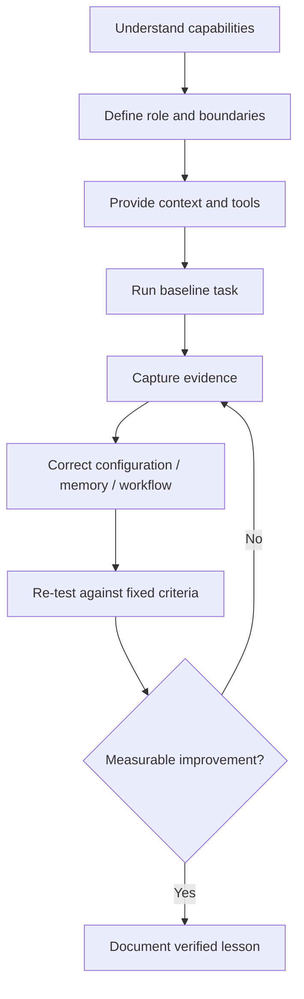

# HTTYA curriculum and publishing sequence

This is an editorial plan, not a claim that tutorials are drafted, tested or published.

| Track | Competence developed | Example lab |
|---|---|---|
| 01 Meet Your Agent | Capability boundaries, roles, instructions | Write an agent role contract |
| 02 Teach Your Agent | Context, memory, corrections, evaluation | Test recall across sessions with external memory |
| 03 Equip Your Agent | Tools, files, actions, permissions | Give one tool least privilege and test failure |
| 04 Trust Your Agent | Approvals, accountability, provenance | Freeze observations before rules and recommendation |
| 05 Introduce Other Agents | Directional trust, handoffs, multi-agent design | Human-approve a FRIENDS.md trust relationship |
| 06 Grow Together | Ongoing review, measurable progress | Compare baseline vs revised agent on a fixed task |

## Suggested launch curriculum (draft candidates)
1. **Start Here: What Does It Mean to Train an Agent?** — terminology, limits, learning loop; baseline exercise.
2. **Give Your Agent a Map** — common instructions, project context, AGENTS.md; based on 'Give Every Agent the Same Map'.
3. **Turn One SOP into an Agent Workflow** — one repeatable procedure, inputs, guardrails, evaluation.
4. **Define an Agent's First Job** — role contract, tool permissions, acceptance criteria; informed by role-based/multi-agent design.
5. **How to Correct an Agent So the Fix Sticks** — classify correction as one-turn, project, external memory, prompt/config, or retraining.
6. **Agent Handoffs Without Guesswork** — explicit handoff schema, identity, approval, evidence, negative test.
7. **Your Agent Needs a Flight Recorder** — provenance and ordering: immutable observation first, then frozen rules, then recommendation.
8. **How to Introduce Agents with FRIENDS.md** — each agent's directional map; human-approved admission only.
9. **Standing Agents: Scheduling, Escalations and Review** — real operational boundaries and report fidelity.
10. **Prove Your Agent Actually Improved** — held-out tasks, controlled comparison, evidence and limitations.

## Learning journey

Agents may propose next steps but cannot invent the outcome of evaluation. Humans approve permissions, trust relationships and irreversible actions.

## Initial execution plan
1. Audit source routes and markdown/content files in existing blogs; check for unpublished candidates and duplicates.
2. Select 3 introductory tutorials based on prerequisites and real verifiability.
3. Write and test exercises and Mermaid diagrams, documenting versions/limitations.
4. Define Astro learning UX and machine-readable metadata; prototype without impacting current apps.
5. Confirm domain, deployment configuration and publishing owner.
6. Publish and verify HTTYA routes, then add reciprocal source-blog links with link validation.

**Definition of ready:** accurate source grounding, bounded scope, concrete success condition, clear permissions, and an obtainable test environment.
