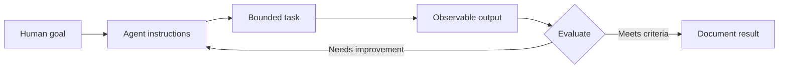

# Tutorial template (draft)

The frontmatter below is a proposal; align the schema with the eventual Astro content collection before shipping.

```yaml
---
title: "Actionable tutorial title"
slug: "stable-tutorial-slug"
summary: "What the learner will be able to do"
track: "02-teach-your-agent"
difficulty: "beginner"
status: "draft" # draft | reviewed | verified | published
estimated_minutes: null # only after timed exercise
prerequisites: []
learning_objectives:
  - "An observable skill"
source_articles: [] # verified original canonical URLs
related_tutorials: []
permissions_required: []
tools_required: []
last_verified: null
verified_environment: null
---
```

## Outcome
In this lesson, you will...

## Prerequisites and safety boundaries
Tools, environment, permissions, approval gates, and a test-only option.

## Mental model

**Text alternative:** A human specifies a goal. Instructions guide a bounded agent task. The output is evaluated; failing outputs produce revisions, and passing outputs are documented.

## Steps
1. ...
2. ...
3. ...

## Working example
Show exact input, expected output format, and a clearly marked example result (never fictional evidence represented as tested).

## Verification
- [ ] Baseline recorded
- [ ] Expected output criteria specified
- [ ] Test executed (or explicitly marked not executed)
- [ ] Observed result captured
- [ ] Permission and failure cases checked

## Troubleshooting
Failure → cause → safe recovery.

## Your turn
A reproducible learner exercise, optional extension and short reflective question.

## For agents
- **Goal:** ...
- **Allowed actions:** ...
- **Requires human approval:** ...
- **Evidence to produce:** ...
- **Do not assume:** ...

## Background reading / related lessons
Verified original source link(s), reciprocal target link(s) once published, and revision date.
